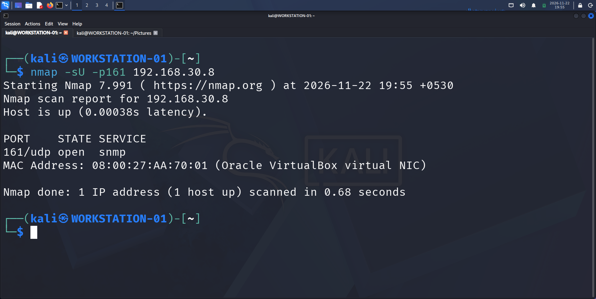
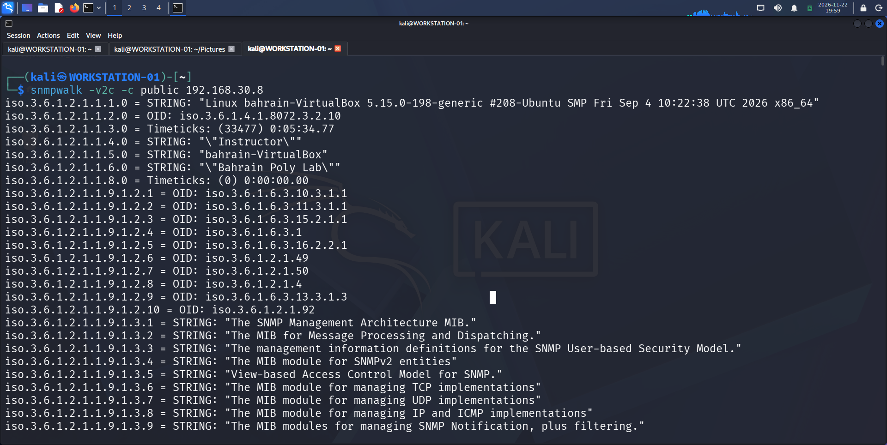
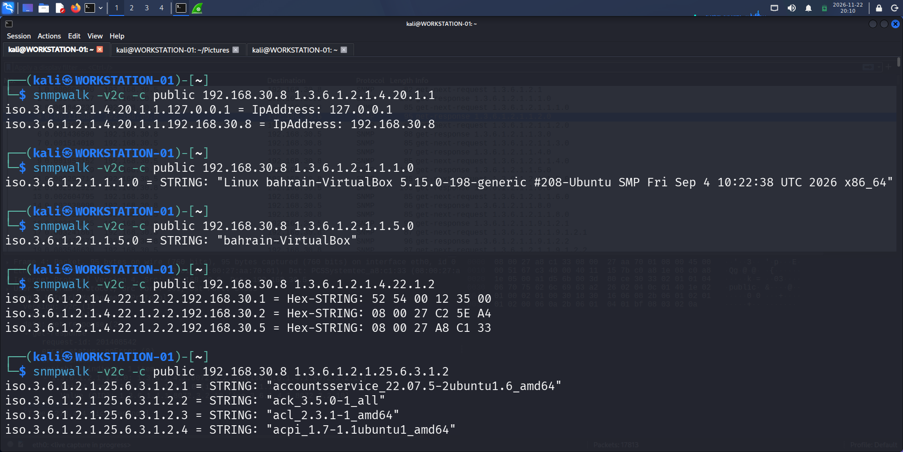
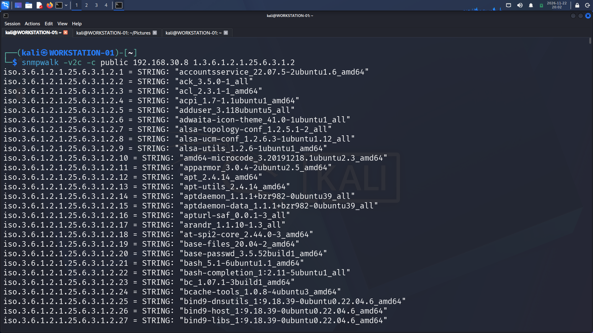
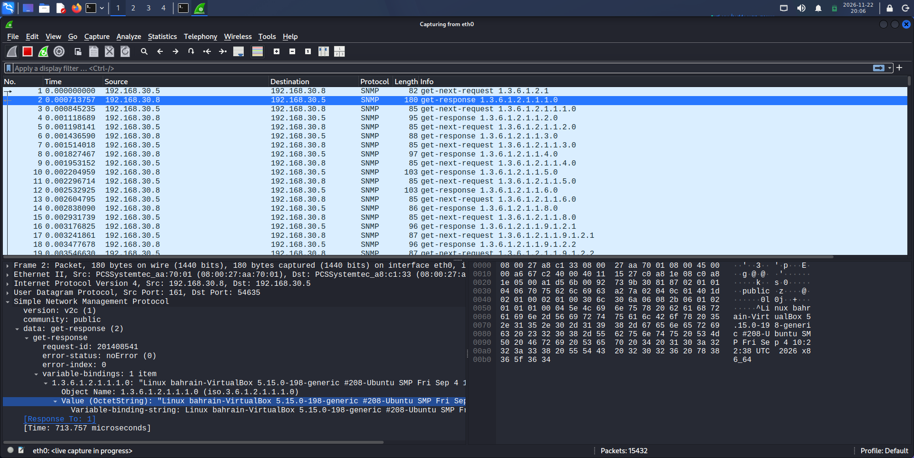

# Bodhi Linux - SNMP Enumeration (Community String Disclosure)

- **Category:** Network Pentesting - Vulnerability Assessment / Enumeration
- **Environment:** Self-hosted lab - Kali Linux (attacker) + Bodhi Linux (target), Host-Only network
- **Tools used:** Nmap, onesixtyone, snmpwalk, Wireshark

## Objective
Identify and enumerate an exposed SNMP service on the target, confirm the use of a weak/default community string, and extract system information to demonstrate the risk of unauthenticated SNMP access.

## Recon / Enumeration
Confirmed UDP port 161 was exposed:
```
nmap -sU -p161 192.168.30.8
```
Result:



## Vulnerability

Identified SNMP community string: **`public`**

This confirms that **SNMPv1/v2c** is enabled and accessible using the default community string **`public`**. SNMPv1 and SNMPv2c rely on community strings for authentication, which are transmitted in plaintext without encryption. The default **`public`** community string typically provides **read-only** access to Management Information Base (MIB) objects, allowing an attacker to enumerate sensitive information such as system details, network interfaces, routing information, running services, and other device configuration data. If a read-write community string such as **`private`** is configured and accessible, an attacker may also be able to modify device settings.

The use of default or weak community strings significantly increases the risk of unauthorized information disclosure and in the case of read-write access, unauthorized configuration changes.

## Exploitation / Enumeration Steps
1. Walked the MIB tree:
   ```
   snmpwalk -v2c -c public 192.168.30.8
   ```
   Result:
   

3. Extracted key OIDs individually:
   | OID | Field | Result |
   |---|---|---|
   | 1.3.6.1.2.1.1.1.0 | sysDescr | `Linux bahrain-VirtualBox 5.15.0-198-generic #208-Ubuntu SMP Fri Sep 4 10:22:38 UTC 2026 x86_64` |
   | 1.3.6.1.2.1.1.5.0 | hostname | `bahrain-VirtualBox` |
   | 1.3.6.1.2.1.1.3.0 | uptime | `0:30:29.33` |
   | 1.3.6.1.2.1.4.20.1.1 | IP Address | `127.0.0.1, 192.168.30.8` |

   
   ### Installed Softwares on Target
   

4. Captured the exchange in Wireshark, filter `snmp` - the community string is visible in plaintext in the packet bytes, confirming no transport-layer protection:

   

## Impact
An attacker can passively enumerate OS version, hostname, running processes, installed software and network topology (ARP/routing tables) without any authentication beyond guessing a commonly-used default string. This directly aids later attack phases - OS/version data narrows down exploit selection, and ARP/routing data maps the internal network for pivoting.

## Remediation
- Disable SNMPv1/v2c; migrate to SNMPv3 (adds authentication + encryption).
- Change default community strings (`public`/`private`) if v1/v2c must remain in use temporarily.
- Restrict SNMP access via ACLs/firewall to management-network IPs only.
- Disable SNMP entirely on hosts that don't require remote monitoring.

## Key Takeaway
A supposedly "read-only" protocol like SNMP can disclose enough system and network detail on its own to meaningfully shrink an attacker's reconnaissance workload - reinforcing why default credentials on *any* service, not just login panels, are a real finding worth reporting.

Your idea is good, but I'd make it clearer that these are **examples of commonly targeted OIDs** rather than implying they always exist on every SNMP-enabled device. Here's a more professional version:

## Appendix – Commonly Enumerated SNMP OIDs

The following OIDs were **not queried during this assessment**. They are included for reference to demonstrate the types of information an attacker may attempt to retrieve after discovering a valid SNMP community string (or weak SNMPv3 credentials). Availability depends on the target device, operating system, installed MIBs, access control policies, and SNMP configuration. Scalar OIDs (ending in `.0`) return a single value, whereas table/columnar OIDs typically require subtree traversal (`snmpwalk` / `snmpbulkwalk`) to retrieve full sets of entries.

| OID | Category | Potential Information |
|------|----------|-----------------------|
| `1.3.6.1.2.1.1.4.0` | System | System administrator contact information |
| `1.3.6.1.2.1.1.6.0`  | System | Physical location of the device |
| `1.3.6.1.4.1.77.1.2.25`  | User Accounts | Windows/LAN Manager user account names |
| `1.3.6.1.2.1.25.1.6.0`  | Processes | Number of running processes |
| `1.3.6.1.2.1.25.4.2.1.2` | Processes | Running process and software names (indexed by PID) |
| `1.3.6.1.2.1.2.2.1.2`  | Network | Network interface descriptions |
| `1.3.6.1.2.1.4.20.1.1`  | Network | IPv4 addresses assigned to interfaces |
| `1.3.6.1.2.1.4.21.1.1`  | Network | IPv4 routing table destination entries |


These OIDs illustrate why an exposed SNMP service is considered a valuable reconnaissance target. Depending on the device and its configuration, successful enumeration can reveal administrative contact information, device location, user accounts, running processes, network interfaces, IP addressing, and routing information. Such data can help an attacker fingerprint the environment, identify potential attack paths, and plan subsequent stages of an intrusion.
