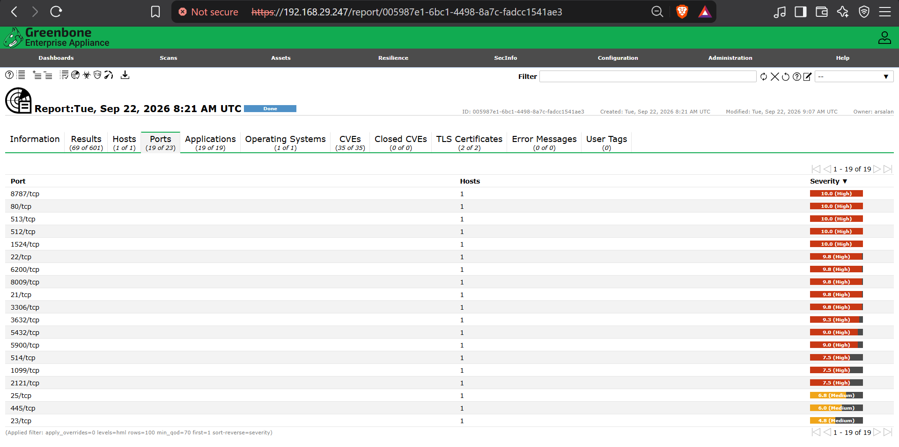
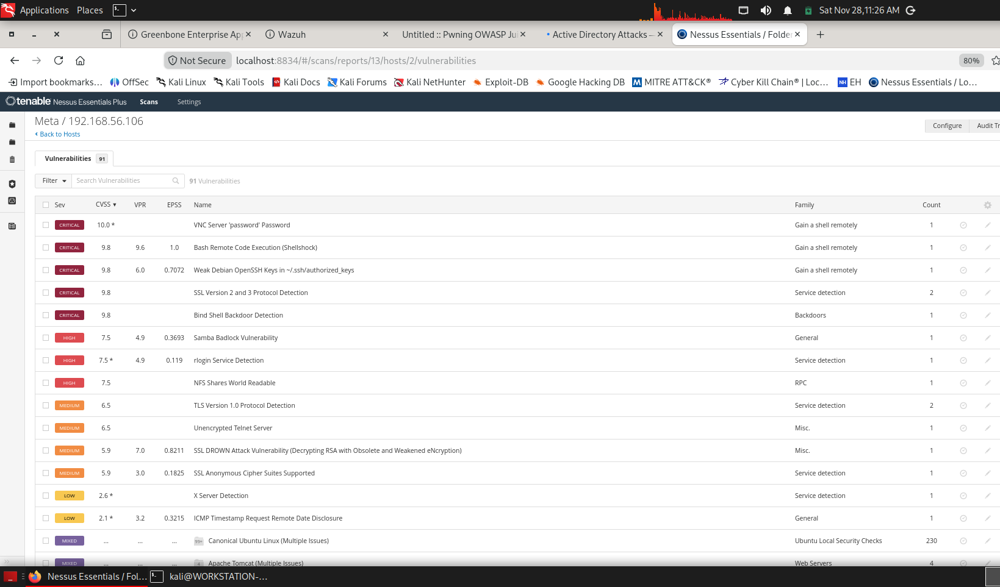
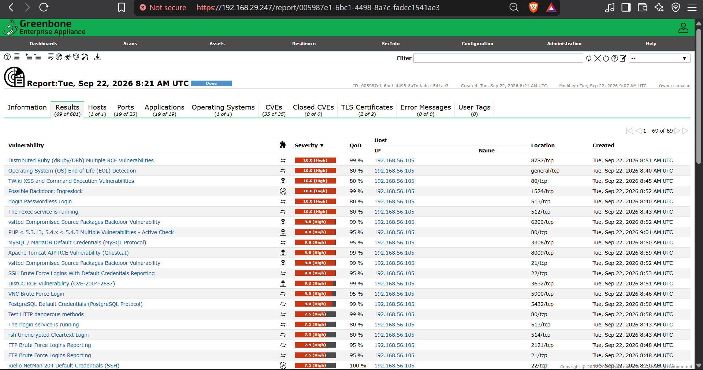
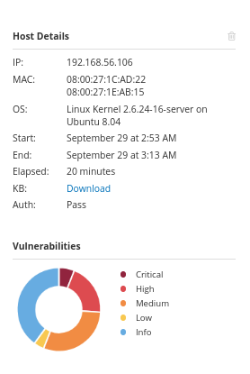

# Metasploitable2 Vulnerability Assessment Report

- **Category:** Vulnerability Assessment
- **Environment:** Self-hosted lab Kali Linux (Greenbone + Nessus scanners), Metasploitable2 (target), Host-Only network
- **Tools used:** Greenbone (OpenVAS), Tenable Nessus used together for cross-validated coverage

## Objective
Identify, assess and prioritize security weaknesses on the target system, producing a consolidated risk-ranked report rather than relying on a single scanner's output.

## Methodology
Scanned the target with both Greenbone and Nessus independently, then cross-referenced results against each other and against manual Nmap-based enumeration from an earlier assessment a single scanner's findings were not treated as final without confirmation.

## Consolidated Findings (Risk-Ranked)

| Port/Service | Finding | CVE | Severity (CVSS) | Confirmed By | Notes |
|---|---|---|---|---|---|
| 21/FTP | vsftpd 2.3.4 Backdoor | CVE-2011-2523 | Critical 9.8 | Nmap + Greenbone + Nessus | Actually exploited in a separate writeup unauthenticated RCE, highest-confidence finding in this assessment regardless of scanner coverage. |
| 22/SSH | Weak Debian OpenSSH Keys | CVE-2026-60002, CVE-2023-38408 | Critical 9.8 | Nmap + Greenbone + Nessus | All three tools agree strongest cross-validated finding. Nmap/Greenbone exploited via default creds (msfadmin:msfadmin); Nessus flagged the underlying predictable-key weakness. |
| 1524/Bind Shell | Ingreslock Backdoor | N/A | Greenbone: 10 / Nessus: 9.8 (Critical) | Greenbone + Nessus | Both independently detected an open root shell. Scoring differs slightly between tools (10 vs 9.8). |
| 5900/VNC | Weak/default password | N/A | Greenbone: 9 / Nessus: 10.0 (Critical) | Greenbone + Nessus | Both confirmed access via password `password`. Nessus scored it maximum critical, Greenbone one tier lower. |
| 25,5432/SSL | SSLv2/v3 Deprecated Protocols | N/A | Greenbone: 6.8 (Medium) / Nessus: 9.8 (Critical) | Greenbone + Nessus | Same underlying issue, **very different severity scoring** between tools worth highlighting as a key divergence. |
| 5432/PostgreSQL | Weak Cipher Suites / SSL DROWN | CVE-2013-2566, CVE-2015-2808, CVE-2015-4000 | Medium 5.9 | Greenbone + Nessus | Exact CVSS match between tools strong agreement. |
| (Bash) | Shellshock RCE | CVE-2014-6271 (family) | Critical 9.8 (EPSS 1.0) | **Nessus only** | Not present anywhere in Greenbone's reported findings a major coverage gap given this is a remote-code-execution vuln with maximum exploitability score. |
| 2049/NFS | NFS Shares World Readable | N/A | High 7.5 | **Nessus only** | Greenbone listed this port as "Not Listed" entirely. |
| 23/Telnet | Unencrypted Telnet Server | N/A | Medium 6.5 | **Nessus only** | Greenbone also marked port 23 "Not Listed." |
| 139,445/SMB | Samba Badlock Vulnerability | N/A | High 7.5 | **Nessus only** | Different Samba vuln than Greenbone found below. |
| 139,445/SMB | Samba MS-RPC RCE | CVE-2007-2447 | Medium 6.0 | **Greenbone only** | Each tool found a *different* Samba issue on the same service neither caught both. |
| 80/Tomcat | Ghostcat AJP RCE | CVE-2020-1938 | Critical 9.8 | Greenbone + Nessus* | Greenbone itemized specifically; Nessus bundled under "Apache Tomcat (Multiple Issues)," 4 issues. |
| 513/rlogin | Passwordless login / service detection | CVE-1999-0651 | High 7.5–10 | Greenbone + Nessus | Confirmed by both, Greenbone found the more severe passwordless variant. |
| Host (OS) | Canonical Ubuntu Linux 230 missing patches | N/A | Mixed | **Nessus only** | Aggregated OS-level patch audit not in Greenbone's per-port table at all. This is actually the single biggest finding: the base OS itself is critically unpatched, independent of any individual service. |

## Risk Summary

This host can be fully compromised without any credentials, through at least three independent paths. The vsftpd 2.3.4 service on port 21 contains a backdoor that was actually exploited in a separate assessment on this same target, returning a root shell directly this isn't a theoretical scanner flag, it's confirmed working. The VNC service on port 5900 was also personally confirmed: it accepted a connection with **no password entered at all**, granting full desktop access with zero authentication required. Separately, both scanners flagged an open bind shell (Ingreslock) on port 1524 and Bash Shellshock as additional unauthenticated remote-code-execution routes these weren't personally exploited in this assessment, but are reported at maximum severity by one or both tools.

Beyond these direct takeover paths, several other exposed services accept default or trivially weak credentials per the scan results: SSH and FTP both accept `msfadmin:msfadmin`, MySQL allows root login with an empty password, and PostgreSQL accepts `postgres`/`password`. Three more services Telnet, rlogin, and rsh transmit these credentials in plaintext by design, meaning anyone capturing network traffic can harvest valid logins even without guessing them.

Finally, the underlying OS itself carries 230 unapplied security patches, meaning even if every individual service above were hardened, the base Ubuntu installation would still carry a large, unaddressed attack surface. In combination, an attacker doesn't need a sophisticated exploit chain here two of the four unauthenticated-access paths above were personally verified working, and the rest are independently sufficient for full compromise even before considering credential reuse.

## Remediation Priorities
1. **Remove/patch the vsftpd 2.3.4 backdoor** (CVE-2011-2523) unauthenticated RCE, the single most severe and already-confirmed-exploitable finding.
2. **Patch Bash (Shellshock)** (CVE-2014-6271 family) across the host second unauthenticated RCE vector.
3. **Disable/remove the Ingreslock bind-shell backdoor** on port 1524 an open root shell requiring no exploitation at all.
4. **Rotate SSH keys and disable default credentials** (`msfadmin:msfadmin`, `user:user`) closes the strongest cross-validated finding in this report.
5. **Reset default credentials on all remaining services** VNC (`password`), MySQL/MariaDB (root/empty password), PostgreSQL (`postgres`/`password`).
6. **Disable legacy cleartext protocols entirely** Telnet, rlogin, rsh, rexec these transmit credentials unencrypted by design and have no secure configuration.
7. **Apply the 230 pending Ubuntu OS patches** closes the broadest attack surface on the host, independent of any single service.
8. **Patch/upgrade application-layer services** PHP (<5.3.13/5.4.3), Apache Tomcat (Ghostcat, CVE-2020-1938), TWiki, Samba (both CVE-2007-2447 and Badlock).
9. **Disable SSLv2/v3 and weak cipher suites**, enforce TLS 1.2+ across SMTP and PostgreSQL.
10. **Restrict NFS share permissions** remove world-readable access.

## Appendix Scanner Coverage Notes
Running two scanners surfaced meaningful differences worth noting for future assessments:
- **Nessus caught findings Greenbone missed entirely:** Bash Shellshock, NFS world-readable shares, unencrypted Telnet, and the Samba Badlock vulnerability all absent from Greenbone's per-port results. Of these, Shellshock is the most consequential omission, given its maximum EPSS exploitability score.
- **Greenbone caught findings Nessus's top-severity slice didn't show:** the Samba MS-RPC RCE (CVE-2007-2447), TWiki XSS/command execution, and the PHP multi-vulnerability set none of which appeared in Nessus's critical/high list reviewed here.
- **Severity scoring disagreement:** the same SSLv2/v3 deprecated-protocol issue was scored Medium (6.8) by Greenbone but Critical (9.8) by Nessus a four-point CVSS spread for the identical underlying weakness, illustrating that severity scores are not standardized ground truth across tools.
- **Aggregated vs. itemized reporting style:** Nessus rolls related issues into bundled findings (e.g., "Canonical Ubuntu Linux (Multiple Issues)" 230 count; "Apache Tomcat (Multiple Issues)" 4 count), while Greenbone reports each CVE as a discrete line item. Neither style is wrong, but it means raw finding-counts between the two tools aren't directly comparable without unpacking the bundles.
- Cross-referencing against manual Nmap-based enumeration confirmed that the vsftpd backdoor rated Critical by both Nmap's NSE script and Greenbone was not just theoretically risky but **actually exploitable**, as demonstrated in an earlier writeup that obtained a live shell through it. This reinforces that a scanner's severity rating is a starting point for triage, not a substitute for verifying real-world exploitability.

## Key Takeaway
No single scanner produced a complete picture of this host's risk each tool caught critical findings the other missed entirely, and even where both agreed on a vulnerability, their severity scoring sometimes diverged sharply. A real-world vulnerability assessment benefits from cross-tool validation specifically because scanner coverage gaps are not rare edge cases; in this single assessment, each tool independently missed at least one unauthenticated RCE-class finding that the other caught.
