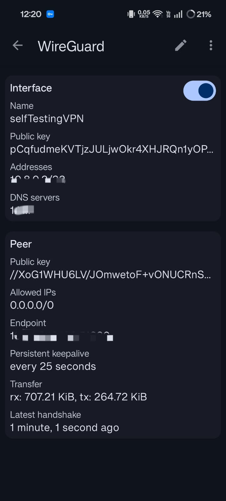
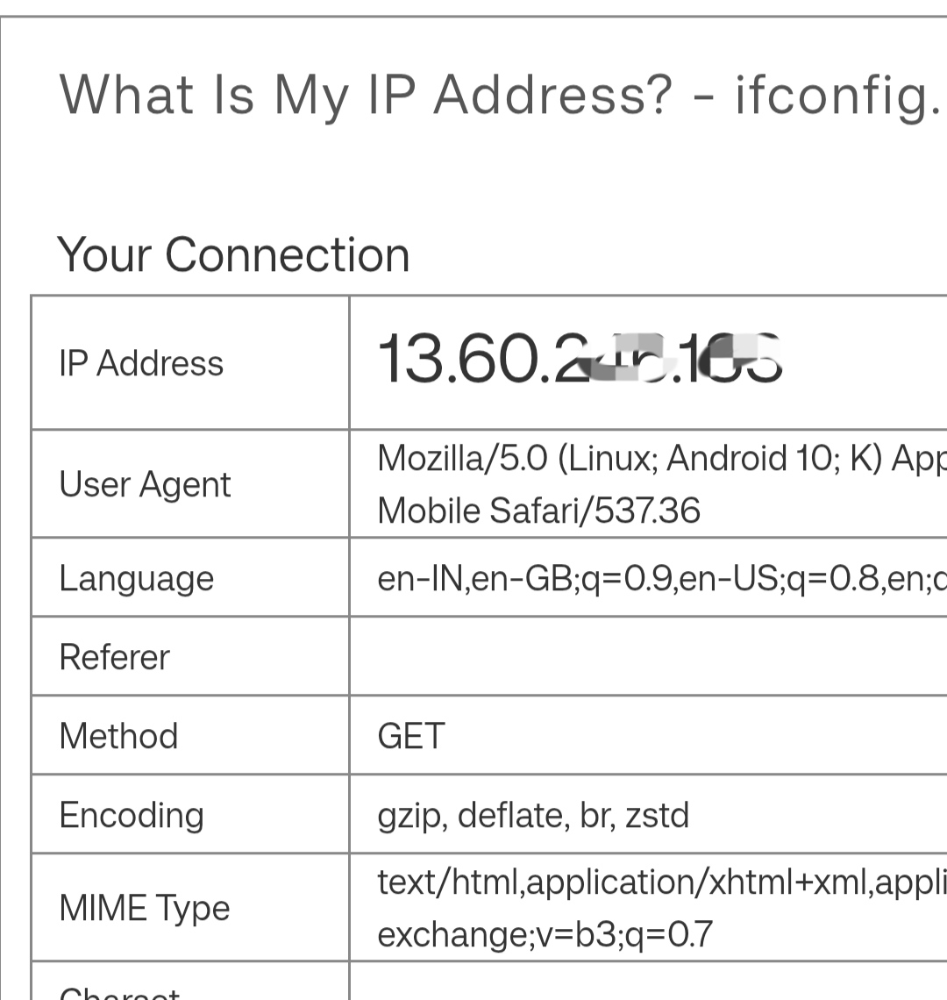
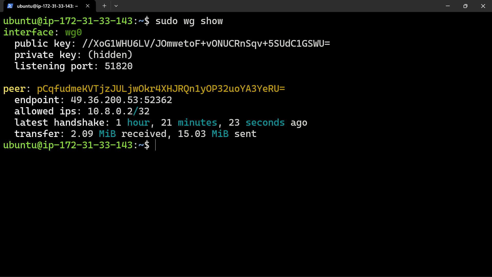
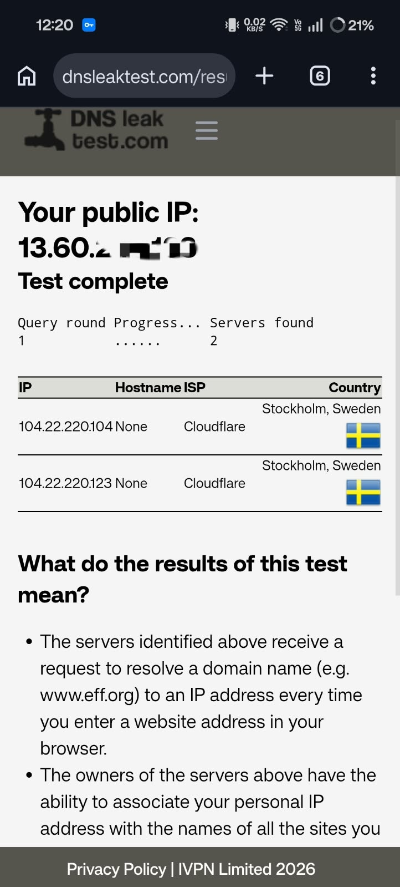

# Building My Own VPN: WireGuard on AWS EC2

## Summary

I deployed a self-hosted WireGuard VPN server on an Ubuntu 24.04 EC2 instance and connected my Android phone to it as a full-tunnel client. All traffic from my phone now routes through the EC2 instance, so any site I visit sees the server's Elastic IP instead of my own. This project covers cloud networking (security groups, NAT, routing), Linux server administration, and practical VPN cryptography.

## Stack
- AWS EC2 (Ubuntu 24.04)
- WireGuard
- iptables NAT
- Android WireGuard client

---

## 1. Infrastructure

### EC2 Instance
- Launched an Ubuntu 24.04 instance on AWS (free tier).
- Attached an **Elastic IP** so the VPN endpoint stays stable across reboots - without this, a stopped/restarted instance gets a new public IP and every client config breaks.

### Security Group
| Port | Protocol | Source | Purpose |
|---|---|---|---|
| 51820 | UDP | 0.0.0.0/0 | WireGuard tunnel |
| 22 | TCP | My IP only | SSH management |

Restricting SSH to my own IP (rather than `0.0.0.0/0`) was a deliberate call - WireGuard itself doesn't need SSH open to the world, and leaving 22 open broadly is one of the most common ways cloud instances get brute-forced.

### Cost Awareness
AWS free tier doesn't make this entirely free: I noted two real cost risks before leaving this running:
- **Public IPv4 address charges** (AWS now bills for IPv4 addresses, including Elastic IPs when unattached or in some account configurations).
- **Outbound data transfer** - since all my phone's traffic now exits through this instance, my transfer volume is directly tied to how much I use the VPN.

I set a billing alert/budget in AWS Billing to catch unexpected charges early, since a VPN server by design can generate much more egress traffic than a typical idle EC2 instance.

---

## 2. Server Setup

### Install WireGuard
```bash
sudo apt update
sudo apt upgrade -y
sudo apt install wireguard -y
```

### Enable IP Forwarding
WireGuard needs the kernel to forward packets between the tunnel interface and the internet-facing interface. Without this, the server can receive tunnel traffic but never relay it onward.

```bash
echo 'net.ipv4.ip_forward=1' | sudo tee /etc/sysctl.d/99-wireguard.conf
sudo sysctl --system
```

### Identify the Network Interface
```bash
ip -br link
```

On this specific instance the interface was `enp39s0` a third naming scheme beyond `eth0`/`ens5`. This matters later, since the NAT rule has to reference the correct interface name, or the outbound traffic silently fails.

### Generate Server Keys
```bash
umask 077
wg genkey | tee server_private.key | wg pubkey > server_public.key
```

`umask 077` sets the default permission mask for any files or directories created by the current shell session.

On Linux, new files are normally created with a maximum permission of **666 (`rw-rw-rw-`)**, while new directories are created with **777 (`rwxrwxrwx`)**. The **umask** removes permission bits from these defaults.

With `umask 077`:

- Files: `666 - 077 = 600` (`rw-------`)
- Directories: `777 - 077 = 700` (`rwx------`)

This means only the file owner can read and write newly created files, and only the owner can access newly created directories. No permissions are granted to the group or other users.

Using `umask 077` before generating WireGuard keys ensures that the private key is created securely with **600** permissions from the moment it is written, preventing other local users from reading the key even briefly during its creation.
### Server Configuration - `/etc/wireguard/wg0.conf`

```ini
[Interface]
Address = 10.8.0.1/24
ListenPort = 51820
PrivateKey =  $(cat /etc/wireguard/server_private.key)
PostUp = iptables -A FORWARD -i %i -o enp39s0 -s 10.8.0.0/24 -j ACCEPT; iptables -A FORWARD -i enp39s0 -o %i -d 10.8.0.0/24 -m conntrack --ctstate RELATED,ESTABLISHED -j ACCEPT; iptables -t nat -A POSTROUTING -s 10.8.0.0/24 -o enp39s0 -j MASQUERADE
PostDown = iptables -D FORWARD -i %i -o enp39s0 -s 10.8.0.0/24 -j ACCEPT; iptables -D FORWARD -i enp39s0 -o %i -d 10.8.0.0/24 -m conntrack --ctstate RELATED,ESTABLISHED -j ACCEPT; iptables -t nat -D POSTROUTING -s 10.8.0.0/24 -o enp39s0 -j MASQUERADE

# Peers are added below
```

- `PostUp`/`PostDown` are the NAT rules: `MASQUERADE` rewrites outbound packet source addresses from the client's tunnel IP (`10.8.0.x`) to the server's own public-facing address, so return traffic from the internet knows how to get back.
- The `FORWARD` rules are deliberately scoped rather than a blanket accept-all: the first only permits traffic *sourced from* the VPN subnet going out via the real interface, and the second only permits the return path for `RELATED,ESTABLISHED` connections (via conntrack) - not arbitrary unsolicited inbound traffic on that interface.

### Lock Down and Start
```bash
sudo chmod 600 /etc/wireguard/wg0.conf
sudo systemctl enable --now wg-quick@wg0
```

---

## 3. Client Setup (Android)

I generated the client's key pair **on the phone itself**, inside the WireGuard Android app - not on the server. This is a meaningful security practice: the private key never touches any device other than the one that uses it, so even a fully compromised server never had a copy of the client's private key.

### Phone-side Tunnel Config
```ini
[Interface]
PrivateKey = <PHONE_PRIVATE_KEY>   # generated on-device, never leaves the phone
Address = 10.8.0.2/24
DNS = 1.1.1.1

[Peer]
PublicKey = <SERVER_PUBLIC_KEY>
Endpoint = <SERVER_IP>:51820
AllowedIPs = 0.0.0.0/0
PersistentKeepalive = 25
```

- `AllowedIPs = 0.0.0.0/0` makes this a **full tunnel** - every packet from the phone, not just traffic to specific destinations, goes through the VPN.
- `PersistentKeepalive = 25` sends a keepalive packet every 25 seconds. This matters specifically because the phone is typically behind NAT (carrier/Wi-Fi), and without a keepalive, the NAT mapping on the phone's side expires, silently breaking the tunnel until new outbound traffic is sent.



### Server-side Peer Entry
Added to the bottom of `/etc/wireguard/wg0.conf`:
```bash
sudo vi /etc/wireguard/wg0.conf
```

```ini
[Peer]
PublicKey = <PHONE_PUBLIC_KEY>
AllowedIPs = 10.8.0.2/32
```
Note the asymmetry: the **server's** `AllowedIPs` for this peer is scoped to `/32` (just that one client's tunnel address) - it only needs to know how to route *to* this specific client, not grant it any wider routing scope.

---

## 4. Troubleshooting (Real Issue Encountered)

**Symptom:** After bringing the interface up, `sudo wg show` displayed `wg0` as up and listening on port `51820`, but **no peer was listed at all** - not even as "never handshaked."

**Root cause:** The original `[Peer]` block on the server referenced a placeholder/incorrect public key. This happened because I'd initially generated a client key pair *on the server* during early testing, then switched to generating the real key pair on the phone (the correct, more secure approach) - but never updated the server config to match the phone's actual public key. The server was listening for a peer that, cryptographically, didn't exist.

**Fix:**
```bash
# Replaced PublicKey under [Peer] with the phone's actual public key
sudo vi /etc/wireguard/wg0.conf

sudo systemctl restart wg-quick@wg0
sudo wg show
```

After the restart, the peer appeared correctly in `wg show`, confirming the key mismatch - not a networking/firewall issue - was the actual cause.

---

## 5. Verification

```bash
# From the phone, confirm public-facing IP matches the server's IP
curl -4 https://icanhazip.com   # or visit https://icanhazip.com in-browser
# On the server, confirm a recent handshake and active data transfer
sudo wg show
```



Expected `wg show` output includes a recent `latest handshake` timestamp and non-zero `transfer` values for both directions.




- Checked [dnsleaktest.com](https://dnsleaktest.com) to confirm DNS queries were resolving through `1.1.1.1` (the DNS set in the client config) rather than leaking to my ISP's resolver - a full-tunnel VPN that still leaks DNS defeats much of the point.



- Confirmed the service survives a reboot:
  ```bash
  systemctl is-enabled wg-quick@wg0
  # should return: enabled
  ```

---

## 6. Adding a New User / Device

This is the repeatable process for connecting any additional client (another phone, a laptop, etc.) going forward.

**On the new client device:**

1. Install the WireGuard app/client.

2. Generate a new key pair **on that device** (same principle as the phone - private keys never leave the device they are generated on).

3. Pick the next free tunnel IP (e.g. `10.8.0.3/24` for a second client, `10.8.0.4/24` for a third, incrementing from there).

4. Register the device on the server - applies instantly, no restart needed:
   ```bash
   sudo wg set wg0 peer <NEW_DEVICE_PUBLIC_KEY> allowed-ips 10.8.0.3/32 #new_device_vpn_ip
   ```

5. Make it permanent:
   ```bash
   sudo nano /etc/wireguard/wg0.conf
   ```
   **Append (once only, no duplicates):**
   ```ini
   [Peer]
   PublicKey = <NEW_PUBLIC_KEY>
   AllowedIPs = 10.8.0.4/32 # vpn ip for the new device
   ```

6. Configure the client device - open WireGuard Client, tap **+** and then, **Create from scratch**:
   ```ini
   [Interface]
   PrivateKey = <NEW_DEVICE_PRIVATE_KEY>
   Address = 10.8.0.4/24   # vpn ip for the new device
   DNS = 1.1.1.1

   [Peer]
   PublicKey = <SERVER_PUBLIC_KEY>
   Endpoint = <SERVER_IP>:51820
   AllowedIPs = 0.0.0.0/0
   PersistentKeepalive = 25
   ```

7. Connect and verify:
   - Turn the tunnel on.
   - Server: `sudo wg show` → recent handshake, transfer counters rising.
   - Client: open icanhazip.com → should show the server's public IP.

### Checklist for onboarding any new device:
- Key pair generated on the client device itself
- Unique `/32` tunnel IP assigned (never reuse one already in use)
- Server config updated live via `wg set` first, then persisted in `wg0.conf` for reboot survival
- New client confirmed in `wg show` with a handshake after connecting

### Troubleshooting
- No peer in `wg show`: wrong or missing public key in `[Peer]`.
- No handshake: check security group UDP 51820 and the Endpoint IP.
- Handshake but no internet: check `ip_forward = 1` and that the interface name in the `PostUp` NAT rule matches `ip -br link`.

---

## 7. Removing a Device

When a device is no longer trusted or no longer in use remove it.

**Step 1  Remove the peer live (instant, no restart):**
```bash
sudo wg set wg0 peer <DEVICE_PUBLIC_KEY> remove
```

**Step 2  Make the removal permanent:**
```bash
sudo vi /etc/wireguard/wg0.conf
```
Delete that device's entire `[Peer]` block (the `PublicKey` and `AllowedIPs` lines) for that device, then save.

**Step 3  Verify:**
```bash
sudo wg show
```
Confirm the device's public key no longer appears in the peer list at all.

**Note:** removing the peer only revokes server-side trust  it does not touch the device itself. If the device is lost/stolen rather than just retired, treat its tunnel config as compromised: there's no way to "log it out" remotely beyond this removal, since WireGuard has no session/token to invalidate  the public key relationship itself *is* the access grant.

---

## Personal Notes / Quick Reference

Commands I'll want again without re-deriving them:

```bash
# Check VPN status and connected peers
sudo wg show

# Restart the whole interface (drops ALL clients briefly)
sudo systemctl restart wg-quick@wg0

# Reload peer config changes without dropping existing clients
sudo wg syncconf wg0 <(wg-quick strip wg0)

# Confirm auto-start on reboot
systemctl is-enabled wg-quick@wg0

# View live interface + firewall state
sudo wg
sudo iptables -t nat -L -v
```

**Things to remember before touching this again:**
- Interface name on this box is `enp39s0` - always re-verify with `ip -br link` on any new instance; don't assume `eth0`/`ens5` from a tutorial.
- If a peer never appears in `wg show` at all (not even unhandshaked) - it's a key mismatch, not a firewall problem.
- Elastic IP must stay attached, or every client config's `Endpoint` goes stale on next reboot.
- Watch the AWS billing dashboard - this instance's egress cost profile is fundamentally different from a normal idle EC2 box, since it's now proxying all my phone's traffic.

